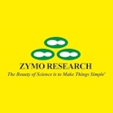
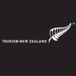
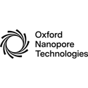
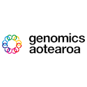
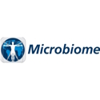
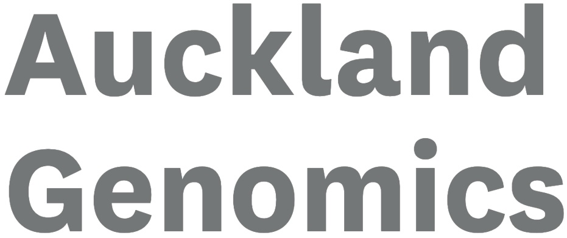

The [GSC27 Agenda Booklet](add google drive URL here) will be available as soon as its ready.

Summary of themes will be added here soon.

# Confirmed speakers include:

### [Mario Murakami](https://scholar.google.com.br/citations?user=Ff5cpsUAAAAJ&hl=pt-BR)

### [David Roos](https://web.sas.upenn.edu/endowed-professors/roos/)

### [Folker Meyer](https://www.ikim.uk-essen.de/groups/ds)

### [Joana Pauperio](https://www.ebi.ac.uk/people/person/joana-pauperio/) EBI
### [Montana Smith](https://www.pnnl.gov/people/montana-smith) PNNL

# Agenda (8:30 am - 5:00 pm)
July 27: GSC board meeting
## Day 1: July 28th
Welcome Opening, keynote and technical talks
## Day 2: July 29th
keynote and technical talks, MIxS hands-on workshop; Poster session and Evening Reception
**Evening Networking**: 
## Day 3: July 30th
keynote and technical talks. Handoff GSC28 & Meeting Closing
 

## Thank you to our sponsors

<!-- add links to small logos of each sponsor here as they sign up
	

 

-->

